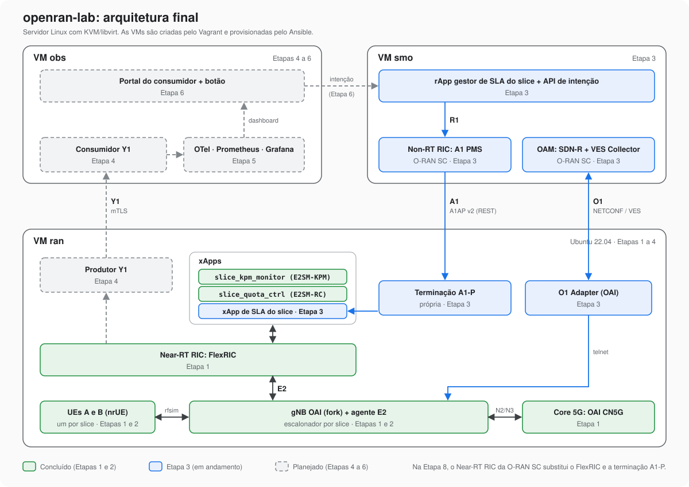

# openran-lab

Laboratório OpenRAN reproduzível para estudo e pesquisa: gNB e UE do OpenAirInterface (OAI/Duranta) com RF simulado, core 5G OAI CN5G e Near-RT RIC FlexRIC. Tudo roda em VMs KVM criadas com Vagrant e provisionadas com Ansible.

O objetivo final é um cenário em que o consumidor de um slice acompanha dados da RAN num dashboard (via interface **Y1**) e, com um botão, pede mais recursos. O pedido percorre o caminho O-RAN (SMO → rApp → **A1** → xApp → **E2**) até o gNB.

> **Status:** em desenvolvimento. As Etapas 1 e 2 estão concluídas (releases `v0.1.0` e `v0.2.0`); a próxima é a Etapa 3, o caminho O-RAN completo. Veja o [roadmap](docs/roadmap.md).



Verde: pronto (Etapas 1 e 2). Azul: Etapa 3, em andamento. Cinza tracejado: planejado. Detalhes de cada interface e VM na [arquitetura](docs/architecture.md).

## Status das etapas

| Etapa | Entrega | Status |
| --- | --- | --- |
| 1 | RAN + core + E2 (OAI gNB/nrUE em rfsim, OAI CN5G, FlexRIC) | Concluída (`v0.1.0`) |
| 2 | Multi-slice (dois slices, dois UEs, xApp de slicing) | Concluída (`v0.2.0`, [guia](docs/stages/02-multi-slice.md)) |
| 3 | Caminho O-RAN com FlexRIC (SMO, Non-RT RIC, rApp, terminação A1-P, O1) | Em andamento: passo 3.1 (rede e VM `smo`) concluído ([guia](docs/stages/03-oran-path.md)) |
| 4 | Interface Y1 (produtor e consumidor com mTLS) | Planejada |
| 5 | Observabilidade (OpenTelemetry, Prometheus, Grafana) | Planejada |
| 6 | Botão de ação para o consumidor e atalho de laboratório | Planejada |
| 7 | Automação completa e experimento final | Planejada |
| 8 | Near-RT RIC da O-RAN SC no lugar do FlexRIC, para comparação | Planejada |

## O que roda hoje (Etapas 1 e 2)

```
VM ran (Ubuntu 22.04)
├── OAI CN5G (Docker): AMF, SMF, UPF, ext-dn... com os slices 1.000001 e 1.000002
├── nr-softmodem (gNB do fork do OAI, --rfsim) ── N2/N3 ──► CN5G
│   ├── escalonador DL por slice (cotas min/max/dedicated)
│   └── agente E2 ── E2 ──► nearRT-RIC (FlexRIC)
├── nr-uesoftmodem ×2 (um por slice, cada um no seu namespace) ── IQ via TCP ──► gNB
└── xApps ──► nearRT-RIC
    ├── slice_kpm_monitor: PRBs e vazão por slice (E2SM-KPM)
    └── slice_quota_ctrl: muda as cotas de PRB por slice (E2SM-RC)
```

O gNB vem de um fork do OAI com o escalonador por slice e o controle das cotas pela E2, porque o OAI da tag fixa não controla PRBs por slice por nenhum service model (veja a [investigação](docs/stages/02-multi-slice-investigation.md)). Sem cotas configuradas, o gNB do fork se comporta como o do OAI original.

A figura no início desta página mostra onde isso entra na arquitetura final, com as VMs `obs` e `smo`.

## Documentação

| Para | Leia |
| --- | --- |
| Entender o projeto e o plano | Este README, a [arquitetura](docs/architecture.md) e o [roadmap](docs/roadmap.md) (etapas, critérios de aceite, experimento final e riscos) |
| Subir e usar o cenário | O guia de cada etapa: [Etapa 1](docs/stages/01-ran-core-e2.md) (um UE) e [Etapa 2](docs/stages/02-multi-slice.md) (dois slices e as xApps) |
| Saber por que algo é assim | O [registro de decisões](docs/decisions.md), com o contexto, o motivo e as consequências de cada escolha técnica |
| Ver como o cenário foi testado | A seção [Testes e resultados](#testes-e-resultados) abaixo e os [testes da Etapa 2](docs/stages/02-multi-slice-tests.md) |
| Resolver um problema | A [solução de problemas](docs/troubleshooting.md), com sintoma, causa e solução dos casos já vistos |
| Acompanhar as mudanças | O [CHANGELOG](CHANGELOG.md), por versão |

## Pré-requisitos

Antes de começar, o servidor precisa ter:

- Linux x86_64 com virtualização por hardware (Intel VT-x ou AMD-V) habilitada na BIOS;
- CPU com **AVX2**, que o OAI exige (AVX-512 é aproveitado se existir);
- recursos livres para a VM `ran` (Etapas 1 e 2): **8 vCPUs, 16 GB de RAM e cerca de 100 GB de disco**. Com os dois UEs saturados, a CPU da VM chega a 93%;
- a partir da Etapa 3, também para a VM `smo`: **2 vCPUs e 6 GB de RAM**;
- **KVM/libvirt, Vagrant, o plugin vagrant-libvirt e Ansible** instalados;
- o seu usuário nos grupos `libvirt` e `kvm`.

Versões com que o laboratório foi testado:

| Componente | Versão testada |
| --- | --- |
| Sistema do host | Ubuntu 24.04.5 LTS |
| QEMU/KVM | 8.2.2 |
| libvirt | 10.0.0 |
| Vagrant | 2.4.9 |
| vagrant-libvirt | 0.12.2 |
| Ansible | ansible-core 2.21.5 |

Problemas comuns na preparação do host estão em [docs/troubleshooting.md](docs/troubleshooting.md).

## Início rápido

```bash
git clone https://github.com/viniciussimao/openran-lab.git
cd openran-lab

cp config.example.yml config.yml   # ajuste CPU, RAM e rede ao seu servidor
./scripts/preflight.sh             # confere se o host atende aos requisitos

vagrant up                         # cria e provisiona as VMs habilitadas
vagrant ssh ran                    # entra na VM da RAN
```

O `vagrant up` compila o OAI (do fork) e o FlexRIC, compila as xApps e sobe o core 5G na VM `ran`. Isso pode levar mais de uma hora. Subir o nearRT-RIC, o gNB, os UEs e as xApps continua manual:

- **cenário com dois slices e as xApps:** seção "Como executar" do [guia da Etapa 2](docs/stages/02-multi-slice.md#como-executar);
- **cenário mínimo, com um UE:** passo 5 do [guia da Etapa 1](docs/stages/01-ran-core-e2.md).

## Configuração

O `Vagrantfile` lê o `config.yml`. Se ele não existir, usa o `config.example.yml`. O `config.yml` não vai para o Git, então cada servidor tem o seu.

| Chave | Para que serve |
| --- | --- |
| `box` | Box do Vagrant usada em todas as VMs |
| `management_network.name` | Nome da rede de gerenciamento criada pelo vagrant-libvirt |
| `management_network.address` | Sub-rede dessa rede, no formato CIDR |
| `vms.<nome>.enabled` | Liga ou desliga a VM (`ran`, `obs`, `smo`) |
| `vms.<nome>.cpus` / `memory_mb` | Recursos de cada VM |
| `lab_network.name` / `address` | Nome e sub-rede (CIDR) da rede privada entre as VMs. O primeiro endereço fica com o host |
| `vms.<nome>.ip` | IP fixo da VM na rede privada |

### Nomes das VMs e rede

As VMs aparecem no libvirt com nomes fixos: `openran-ran`, `openran-obs` e `openran-smo`. Dentro do Vagrant, use só o nome curto (`vagrant ssh ran`).

Cada VM tem duas interfaces:

- **`eth0`, rede de gerenciamento** do vagrant-libvirt, com DHCP e NAT: é por onde o Vagrant e o Ansible entram e por onde a VM acessa a internet;
- **`eth1`, rede privada `openran-lab`**, isolada e com IP fixo (`ran` 192.168.150.10, `smo` .20 e `obs` .30 no modelo): é por onde as VMs se falam (A1, O1 e Y1). Cada VM conhece as outras pelo nome (`openran-ran`, `openran-smo`, `openran-obs`), registrado no `/etc/hosts` pela role `common`.

Se a sub-rede padrão de uma das redes (`192.168.121.0/24` e `192.168.150.0/24`) já estiver em uso no seu servidor, troque `management_network` ou `lab_network` no `config.yml`. O `scripts/preflight.sh` avisa quando isso acontece.

## Versões fixas dos componentes

Para que o cenário seja reproduzível, as versões ficam fixas em [`ansible/group_vars/all.yml`](ansible/group_vars/all.yml):

| Componente | Versão |
| --- | --- |
| OAI RAN (Duranta) | tag `2026.w46` (commit `cb98db5b`), base do fork |
| Fork do OAI (gNB e nrUE) | [`viniciussimao/openairinterface5g`](https://github.com/viniciussimao/openairinterface5g), branch `rc-slice-ctrl`, commit `000b2090` |
| FlexRIC | commit `ea6d9b4` do upstream, como submódulo do fork (compilado com gcc-12) |
| OAI CN5G | v2.2.2 (imagens fixadas por digest) |
| E2AP / E2SM-KPM | v3 / v3.00 (iguais no OAI e no FlexRIC) |
| SO das VMs | Ubuntu 22.04 (`generic/ubuntu2204`) |

O fork é ligado por `oai_slice_scheduler_enabled` (padrão `true`); com `false`, o provisionamento usa o OAI da tag, sem o escalonador por slice.

Qualquer atualização de versão é registrada no [CHANGELOG](CHANGELOG.md).

## Testes e resultados

Cada etapa só é concluída depois de passar no critério de aceite, no servidor de teste (Ubuntu 24.04, 12 CPUs, 30 GB), com rfsim.

| Etapa | Critério de aceite | Resultado |
| --- | --- | --- |
| 1 | O UE pinga o ext-dn do core, e a `xapp_kpm_moni` mostra métricas por UE | `ping` 5/5, E2 Setup com KPM, RC, CCC e SLICE, e métricas por UE na xApp. Validado também com `vagrant destroy` e `vagrant up` do zero ([guia](docs/stages/01-ran-core-e2.md)) |
| 2 | Mudar a cota de um slice muda a vazão medida com `iperf3` | Cotas trocadas de 30/70 para 70/30 pela E2: o UE 1 foi de 38 para 75 Mbit/s e o UE 2, de 74 para 38 Mbit/s. Além disso, o escalonador (T0 a T6), o KPM por slice (K1 a K4) e o controle pela E2 (C1 a C5) passaram nos próprios critérios ([testes da Etapa 2](docs/stages/02-multi-slice-tests.md)) |

Os valores de vazão são do rfsim, limitados pela CPU da VM, e não representam rádio real; os testes comparam variações relativas entre slices.

## Estrutura do repositório

```
openran-lab/
├── AGENTS.md                # instruções para agentes de IA (o CLAUDE.md importa este arquivo)
├── Vagrantfile              # VMs definidas a partir do config.yml
├── config.example.yml       # modelo de configuração por servidor
├── ansible/
│   ├── ansible.cfg
│   ├── site.yml             # playbook principal
│   ├── group_vars/all.yml   # versões fixas
│   └── roles/               # common, docker, oai_ran, flexric, oai_cn5g, xapps
├── configs/
│   ├── ue.conf              # configuração do nrUE (copiada para a VM)
│   └── ue-slice1.conf, ue-slice2.conf  # um UE por slice (Etapa 2)
├── scripts/
│   ├── preflight.sh         # verificação do host
│   ├── multi-ue-ns.sh       # namespaces dos nrUE (Etapa 2)
│   └── slice-prb-share.sh   # resumo das linhas [SLICE] do gNB (Etapa 2)
├── xapps/                   # xApps próprias, em C (Apache-2.0)
│   ├── README.md
│   ├── slice_kpm_monitor/   # KPM por slice (Etapa 2)
│   └── slice_quota_ctrl/    # cotas por slice pelo E2SM-RC (Etapa 2)
├── docs/
│   ├── architecture.md
│   ├── decisions.md         # registro das decisões técnicas
│   ├── roadmap.md
│   ├── troubleshooting.md
│   └── stages/              # guias das etapas
│       ├── 01-ran-core-e2.md
│       ├── 02-multi-slice.md                # como executar e como funciona
│       ├── 02-multi-slice-tests.md          # roteiros e resultados dos testes
│       ├── 02-multi-slice-investigation.md  # leitura de código que levou ao fork
│       └── 03-oran-path.md                  # Etapa 3: investigação e desenho
└── .github/                 # CI (lint) e modelos de issue e PR
```

## Como contribuir

Veja o [CONTRIBUTING.md](CONTRIBUTING.md). Em resumo: nomes de arquivos e variáveis em inglês, documentação e comentários em português, commits no padrão Conventional Commits.

## Licença

O código deste repositório é distribuído sob a [Apache License 2.0](LICENSE).

O repositório **não redistribui** código de terceiros. O OAI RAN (Duranta), o OAI CN5G e o FlexRIC são baixados durante o provisionamento e seguem as próprias licenças. O fork do OAI usado pelo gNB segue a licença do OAI (CSSL v1.0); veja o [NOTICE](NOTICE).
