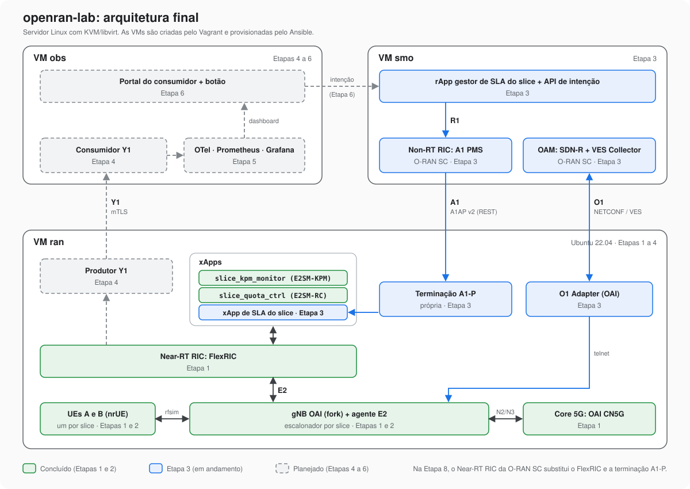

# Arquitetura

O laboratório chega ao cenário final em oito etapas (veja o [roadmap](roadmap.md)). Esta página descreve a arquitetura final e o papel de cada interface O-RAN.

## Visão geral

As cores mostram o status: verde, pronto (Etapas 1 e 2); azul, Etapa 3, em andamento; cinza tracejado, planejado. A figura é um SVG editável à mão em `docs/images/architecture.svg`.

O rApp decide, a xApp executa e o Y1 mostra o resultado. O caminho SMO → rApp → A1 → E2 vem primeiro, na Etapa 3, acionado pela API de intenção do rApp. Na Etapa 6, o botão do portal passa a chamar essa API, e um atalho (um serviço de controle que fala direto com a xApp) entra para comparar os dois caminhos.

Na Etapa 8, o FlexRIC e a terminação A1-P própria dão lugar ao Near-RT RIC da O-RAN SC, que termina o A1 com o A1 Mediator. Todo o resto do diagrama fica igual, para que os dois Near-RT RICs possam ser comparados no mesmo experimento.

## Interfaces

| Interface | Liga | Função no laboratório | Implementação |
| --- | --- | --- | --- |
| **E2** | Near-RT RIC ↔ gNB | Métricas (E2SM-KPM) e controle da RAN, laço de 10 ms a 1 s | Agente E2 do OAI + FlexRIC (Etapas 1 a 7) ou Near-RT RIC da O-RAN SC (Etapa 8) |
| **A1** | Non-RT RIC → Near-RT RIC | Políticas declarativas (ex.: alvo de vazão de um slice) | Lado Non-RT: A1 Policy Management Service da O-RAN SC (pronto). Lado Near-RT: terminação A1-P própria no FlexRIC (Etapa 3) ou A1 Mediator da O-RAN SC (Etapa 8) |
| **O1** | SMO ↔ nós da RAN | Configuração, alarmes e desempenho via NETCONF/YANG e VES | O1 Adapter do OAI (pronto) + OAM da O-RAN SC: SDN-R/OpenDaylight e VES Collector (pronto) |
| **Y1** | Near-RT RIC → consumidores externos | Exposição de informações analíticas da RAN (RAI) | Produtor e consumidor próprios, seguindo o Y1AP |
| **R1** | rApps ↔ plataforma Non-RT RIC | Acesso do rApp aos serviços de A1, dados e O1 | Plataforma da O-RAN SC |

## VMs

| VM | Conteúdo | Etapas |
| --- | --- | --- |
| `ran` | OAI CN5G, gNB, nrUEs, Near-RT RIC (FlexRIC ou O-RAN SC), xApps, produtor Y1, terminação A1-P, O1 Adapter | 1 a 8 |
| `obs` | Consumidor Y1, OpenTelemetry Collector, Prometheus, Grafana, portal | 4 a 8 |
| `smo` | SMO, Non-RT RIC, rApp | 3 a 8 |

## Decisões de projeto

- **RF simulado:** o RFsimulator do OAI troca o rádio por amostras IQ via TCP. Toda a pilha acima da camada física é real, inclusive E2 e KPM.
- **Versões fixas:** OAI numa tag semanal, com o gNB compilado de um fork fixado por commit (escalonador por slice e controle das cotas pela E2), e FlexRIC como submódulo desse fork, com as mesmas versões de E2AP e KPM nos dois lados. As versões ficam em `ansible/group_vars/all.yml`.
- **Pronto antes de próprio:** O1 (O1 Adapter do OAI + OAM da O-RAN SC) e o lado Non-RT do A1 (A1 PMS da O-RAN SC) usam software pronto. Código próprio só onde não existe implementação open source: terminação A1-P para o FlexRIC e Y1.
- **Terminação A1-P, não adaptador:** o serviço segue a OpenAPI do A1AP, para que o A1 PMS da O-RAN SC o opere como operaria qualquer Near-RT RIC. A conformidade é testada contra o A1 Simulator e o A1 PMS.
- **Y1 próprio:** nenhum Near-RT RIC open source implementa Y1. A API segue o Y1AP, e cada desvio fica documentado.
- **Comparação entre Near-RT RICs:** a Etapa 8 troca só o Near-RT RIC. Métricas, scripts e séries do Prometheus são os mesmos, para a comparação ser controlada.
- **OpenTelemetry no consumidor:** o Y1 continua sendo a única saída de dados da RAN; o OpenTelemetry só leva esses dados até o dashboard.
